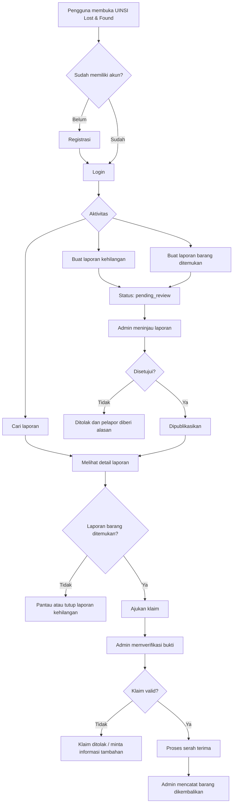
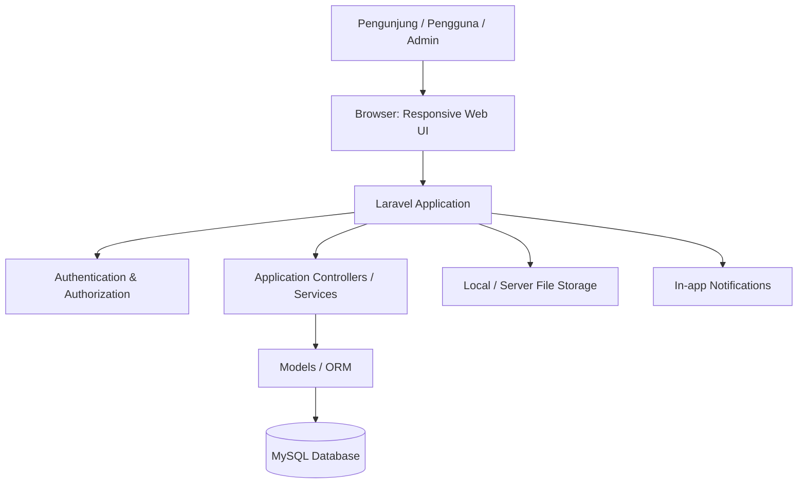
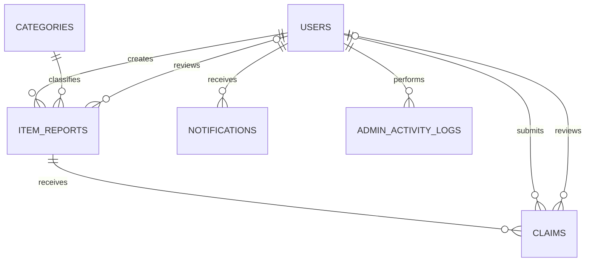

# SYSTEM SPECIFICATION — UINSI LOST & FOUND

> Dokumen acuan analisis, perancangan, dan pengembangan sistem untuk Kelompok 2  
> Mata Kuliah: Manajemen Proyek Sistem Informasi  
> Topik tugas: **Sistem Informasi Pencari Barang yang Hilang di Kampus UINSI**

---

## 0. Status dan cara menggunakan dokumen

Dokumen pembagian kelompok menetapkan topik proyek, tetapi belum menentukan kebutuhan fitur, proses bisnis, teknologi, atau desain sistem secara rinci. Karena itu:

- **Fakta dari tugas:** proyek Kelompok 2 adalah sistem informasi pencari barang yang hilang di kampus UINSI.
- **Rancangan yang diusulkan:** nama produk, alur kerja, fitur, aturan bisnis, struktur data, teknologi, dan kriteria penerimaan dalam dokumen ini merupakan usulan awal yang perlu dikonfirmasi melalui diskusi kelompok dan, bila memungkinkan, wawancara singkat dengan calon pengguna/pihak kampus.
- Jangan mengklaim bahwa sistem telah terintegrasi dengan akun akademik, SIAKAD, data mahasiswa, atau layanan resmi UINSI. Integrasi tersebut tidak termasuk rancangan MVP.

Gunakan dokumen ini sebagai:

1. Acuan menyusun proposal proyek.
2. Spesifikasi kebutuhan sebelum coding.
3. Pedoman desain UI/UX dan database.
4. Instruksi konteks untuk AI coding agent.
5. Checklist pengujian dan pemeriksaan hasil akhir.

## 1. Identitas dan gambaran produk

### 1.1 Nama sistem

**UINSI Lost & Found**

Nama deskriptif: Sistem Informasi Pencarian dan Pelaporan Barang Hilang dan Ditemukan di Lingkungan Kampus UINSI.

### 1.2 Ringkasan

UINSI Lost & Found adalah aplikasi berbasis web yang membantu civitas kampus melaporkan barang yang hilang, mengumumkan barang yang ditemukan, mencari laporan berdasarkan informasi barang, serta mengajukan klaim kepemilikan melalui proses verifikasi admin.

### 1.3 Masalah yang ingin diselesaikan

Masalah berikut merupakan hipotesis awal yang perlu divalidasi, bukan hasil survei lapangan:

- Informasi barang hilang atau ditemukan dapat tersebar melalui percakapan pribadi, grup pesan, atau pengumuman informal.
- Informasi tersebut berpotensi sulit dicari kembali ketika jumlah pesan bertambah.
- Orang yang kehilangan barang mungkin tidak mengetahui bahwa barangnya telah ditemukan.
- Belum tentu ada alur pencatatan dan verifikasi klaim yang konsisten.

### 1.4 Tujuan produk

1. Menyediakan tempat terpusat untuk laporan kehilangan dan penemuan barang.
2. Memudahkan pengguna mencari laporan berdasarkan kata kunci, kategori, lokasi, dan tanggal.
3. Membantu pengguna menemukan kemungkinan kecocokan antara barang hilang dan barang ditemukan.
4. Menyediakan proses klaim dan verifikasi agar barang tidak diserahkan kepada pihak yang tidak berhak.
5. Menyimpan riwayat status laporan sehingga proses penanganan dapat dipantau.

### 1.5 Prinsip utama

- **Terpusat:** laporan disimpan dalam satu aplikasi.
- **Mudah digunakan:** alur pelaporan singkat dan responsif di ponsel maupun desktop.
- **Aman:** informasi kontak dan bukti kepemilikan tidak ditampilkan secara publik.
- **Terverifikasi:** laporan dan klaim dapat diperiksa oleh admin.
- **Terukur:** status laporan dan aktivitas penting tercatat.

## 2. Pengguna dan hak akses

Sistem memiliki tiga jenis akses utama.

| Aktor | Hak akses |
|---|---|
| Pengunjung | Melihat halaman informasi dan daftar laporan yang sudah dipublikasikan; melakukan pencarian; mendaftar dan masuk. |
| Pengguna terdaftar | Semua akses pengunjung; membuat laporan kehilangan/temuan; melihat dan mengelola laporan miliknya; mengajukan klaim; melihat status klaim dan notifikasi. |
| Admin | Mengakses dashboard admin; meninjau, menyetujui, menolak, dan menutup laporan; memeriksa klaim; mengelola kategori dan pengguna; melihat riwayat aktivitas. |

### 2.1 Aturan hak akses

- Pengguna hanya dapat mengubah atau menghapus laporan miliknya sendiri selama status dan aturan sistem mengizinkan.
- Pengguna tidak dapat menyetujui laporan atau klaim miliknya sendiri melalui fungsi admin.
- Hanya admin yang dapat mengubah status menjadi `returned`, `resolved`, `rejected`, atau melakukan penutupan administratif.
- Halaman admin harus dilindungi autentikasi dan middleware/otorisasi admin di sisi server. Menyembunyikan tombol di frontend saja tidak cukup.
- Admin tidak boleh melihat kata sandi pengguna. Kata sandi wajib disimpan dalam bentuk hash.

## 3. Ruang lingkup proyek

### 3.1 Fitur yang termasuk dalam MVP

1. Registrasi, login, logout, dan profil pengguna.
2. Dashboard pengguna.
3. Pembuatan laporan barang hilang.
4. Pembuatan laporan barang ditemukan.
5. Daftar laporan publik yang sudah lolos moderasi.
6. Pencarian dan filter laporan.
7. Halaman detail laporan.
8. Rekomendasi kecocokan sederhana antara laporan hilang dan ditemukan.
9. Pengajuan klaim barang ditemukan.
10. Verifikasi laporan dan klaim oleh admin.
11. Pembaruan status laporan dan klaim.
12. Notifikasi dalam aplikasi untuk perubahan status penting.
13. Dashboard admin dan pengelolaan kategori.
14. Riwayat aktivitas administratif dasar.

### 3.2 Fitur yang tidak termasuk dalam MVP

- Aplikasi native Android/iOS.
- Integrasi SIAKAD, SSO, atau direktori mahasiswa UINSI.
- Pengenalan gambar berbasis AI atau pencocokan otomatis dengan machine learning.
- Pelacakan lokasi GPS secara langsung.
- Pembayaran, transaksi, atau sistem denda.
- Chat real-time antar pengguna.
- Integrasi WhatsApp/SMS gateway berbayar.
- Pengelolaan inventaris resmi kampus.

Fitur di luar MVP hanya boleh ditambahkan setelah fitur inti selesai dan disetujui kelompok/dosen.

## 4. Skenario dan alur bisnis

### 4.1 Alur membuat laporan barang hilang

1. Pengguna masuk ke akun.
2. Pengguna memilih menu **Laporkan Kehilangan**.
3. Pengguna mengisi nama barang, kategori, deskripsi, lokasi perkiraan kehilangan, tanggal kehilangan, dan foto opsional.
4. Pengguna mengirim laporan.
5. Sistem menyimpan laporan dengan status `pending_review`.
6. Admin memeriksa kelayakan dan isi laporan.
7. Jika disetujui, status menjadi `published` dan laporan muncul pada daftar publik.
8. Jika ditolak, status menjadi `rejected`; alasan penolakan disampaikan kepada pelapor.
9. Jika barang telah ditemukan pemilik melalui cara lain, pengguna dapat meminta penutupan atau admin mengubah status menjadi `resolved` setelah pemeriksaan.

### 4.2 Alur membuat laporan barang ditemukan

1. Pengguna masuk ke akun.
2. Pengguna memilih menu **Laporkan Barang Ditemukan**.
3. Pengguna mengisi nama/kategori barang, deskripsi umum, lokasi dan tanggal ditemukan, serta foto opsional.
4. Untuk keamanan, pengguna tidak perlu memublikasikan seluruh ciri unik barang. Admin dapat meminta detail tambahan secara privat.
5. Sistem menyimpan laporan dengan status `pending_review`.
6. Admin meninjau laporan dan menyetujui atau menolaknya.
7. Laporan yang disetujui tampil di daftar publik dengan status `published`.
8. Pengguna yang merasa memiliki barang dapat mengajukan klaim.

### 4.3 Alur klaim barang

1. Pengguna membuka detail laporan barang ditemukan.
2. Pengguna memilih **Ajukan Klaim**.
3. Pengguna mengisi alasan klaim dan bukti/ciri khusus yang dapat membuktikan kepemilikan. Informasi ini bersifat privat dan hanya dapat diakses admin.
4. Sistem menyimpan klaim dengan status `submitted`.
5. Admin membandingkan keterangan klaim dengan informasi barang yang tidak dipublikasikan.
6. Admin dapat meminta informasi tambahan (`needs_more_info`), menyetujui (`approved`), atau menolak (`rejected`) klaim.
7. Jika disetujui, admin mengatur proses serah terima sesuai prosedur yang disepakati pihak kampus.
8. Setelah barang benar-benar diserahkan dan diverifikasi, admin mengubah status laporan menjadi `returned`.
9. Sistem mengirim notifikasi kepada pihak terkait.

### 4.4 Alur pencarian dan pencocokan

- Pengguna dapat mencari berdasarkan kata kunci nama barang atau deskripsi publik.
- Pengguna dapat memfilter berdasarkan kategori, jenis laporan (hilang/ditemukan), lokasi, tanggal, dan status publik.
- Sistem dapat menampilkan **kemungkinan kecocokan** berdasarkan kesamaan kategori, kata kunci, lokasi, dan rentang tanggal.
- Hasil pencocokan hanya rekomendasi, bukan bukti bahwa dua laporan merupakan barang yang sama.
- Keputusan kepemilikan tetap melalui verifikasi admin.

### 4.5 Diagram alur tingkat tinggi



## 5. Kebutuhan fungsional

Prioritas: **Must** = wajib untuk MVP; **Should** = penting jika waktu cukup; **Could** = pengembangan lanjutan.

| ID | Kebutuhan | Prioritas | Kriteria ringkas |
|---|---|---|---|
| FR-01 | Registrasi pengguna | Must | Pengguna dapat membuat akun dengan data wajib dan email unik. |
| FR-02 | Login dan logout | Must | Sistem memverifikasi kredensial dan menyediakan logout. |
| FR-03 | Otorisasi peran | Must | Pengunjung, pengguna, dan admin mendapatkan akses sesuai peran. |
| FR-04 | Profil pengguna | Should | Pengguna dapat melihat dan memperbarui informasi profil yang diizinkan. |
| FR-05 | Buat laporan kehilangan | Must | Pengguna dapat mengirim laporan dengan field wajib. |
| FR-06 | Buat laporan barang ditemukan | Must | Pengguna dapat mengirim laporan barang temuan. |
| FR-07 | Moderasi laporan | Must | Admin dapat menyetujui atau menolak laporan dan mengisi alasan. |
| FR-08 | Daftar dan detail laporan | Must | Pengguna dapat melihat laporan yang telah dipublikasikan. |
| FR-09 | Pencarian dan filter | Must | Hasil dapat dicari dan disaring berdasarkan field yang tersedia. |
| FR-10 | Pengajuan klaim | Must | Pengguna dapat mengajukan klaim pada laporan barang ditemukan. |
| FR-11 | Moderasi klaim | Must | Admin dapat meminta informasi tambahan, menyetujui, atau menolak klaim. |
| FR-12 | Pembaruan status | Must | Perubahan status mengikuti aturan transisi yang ditetapkan. |
| FR-13 | Notifikasi aplikasi | Should | Pengguna mendapat notifikasi untuk status laporan/klaim miliknya. |
| FR-14 | Pengelolaan kategori | Should | Admin dapat menambah, mengubah, dan menonaktifkan kategori. |
| FR-15 | Riwayat aktivitas admin | Should | Aksi penting admin dicatat beserta waktu dan pelakunya. |
| FR-16 | Rekomendasi kemungkinan cocok | Should | Sistem menampilkan laporan yang memiliki kemiripan atribut. |

## 6. Kebutuhan nonfungsional

| Aspek | Kebutuhan |
|---|---|
| Usability | Form menggunakan label jelas, petunjuk singkat, validasi, dan pesan kesalahan yang mudah dipahami. |
| Responsive | Tampilan dapat digunakan di ponsel, tablet, dan desktop. |
| Performance | Halaman daftar menggunakan pagination; gambar dioptimalkan; pencarian tidak memuat semua data sekaligus. |
| Security | Validasi server-side, proteksi CSRF, hashing kata sandi, otorisasi setiap aksi, pembatasan upload, dan pembatasan percobaan login bila tersedia. |
| Privacy | Kontak pribadi dan bukti kepemilikan tidak tampil pada halaman publik. |
| Reliability | Kesalahan proses tidak boleh menghasilkan perubahan status setengah jalan; gunakan transaksi database untuk proses yang membutuhkan konsistensi. |
| Maintainability | Kode menggunakan pola MVC, penamaan konsisten, validasi terpisah, dan dokumentasi instalasi. |
| Availability | Untuk prototipe kuliah, target ketersediaan mengikuti lingkungan server/demo yang disediakan; SLA produksi belum ditetapkan. |
| Accessibility | Form dapat digunakan dengan keyboard, kontras teks memadai, dan gambar memiliki teks alternatif bila relevan. |

## 7. Aturan bisnis dan status

### 7.1 Status laporan

Status yang disarankan:

- `pending_review`: laporan menunggu pemeriksaan admin.
- `published`: laporan disetujui dan dapat dilihat publik.
- `claim_pending`: ada klaim yang sedang diperiksa untuk laporan barang ditemukan.
- `resolved`: laporan kehilangan selesai karena pemilik menyatakan barang telah ditemukan.
- `returned`: barang temuan telah diserahkan kepada pemilik dan proses dikonfirmasi.
- `rejected`: laporan ditolak oleh admin.
- `closed`: laporan ditutup dan tidak menerima aktivitas baru.

Transisi yang diizinkan:

| Jenis laporan | Status asal | Status berikutnya yang diizinkan |
|---|---|---|
| Hilang | `pending_review` | `published`, `rejected` |
| Hilang | `published` | `resolved`, `closed` |
| Ditemukan | `pending_review` | `published`, `rejected` |
| Ditemukan | `published` | `claim_pending`, `closed` |
| Ditemukan | `claim_pending` | `published`, `returned`, `closed` |
| Ditemukan | `returned` | `closed` |

Transisi harus diperiksa di backend, bukan hanya dengan membatasi pilihan pada tampilan.

### 7.2 Status klaim

- `submitted`: klaim baru dikirim.
- `under_review`: sedang diperiksa admin.
- `needs_more_info`: admin meminta bukti atau keterangan tambahan.
- `approved`: klaim disetujui.
- `rejected`: klaim ditolak.
- `cancelled`: klaim dibatalkan oleh pengaju atau admin sesuai aturan.

### 7.3 Aturan tambahan

1. Pengguna harus login untuk membuat laporan dan klaim.
2. Setiap laporan memiliki satu pembuat dan satu nomor referensi unik.
3. Laporan berstatus `pending_review` tidak tampil di daftar publik.
4. Pengguna tidak boleh mengklaim laporan yang dibuatnya sendiri, kecuali keputusan aturan proyek diubah secara eksplisit.
5. Satu laporan barang ditemukan dapat menerima lebih dari satu klaim, tetapi maksimal satu klaim dapat disetujui.
6. Jika satu klaim disetujui, klaim lain untuk laporan yang sama harus ditinjau/dibatalkan sesuai keputusan admin.
7. Bukti kepemilikan tidak boleh tampil untuk pengguna lain.
8. Admin wajib mengisi alasan ketika menolak laporan atau klaim.
9. Status `returned` hanya dapat diberikan setelah serah terima benar-benar dilakukan.
10. Penghapusan laporan yang sudah diproses sebaiknya berupa penutupan/soft delete agar jejak proses tetap tersedia.

## 8. Rancangan halaman dan UI/UX

### 8.1 Halaman publik

1. **Beranda**
   - Identitas UINSI Lost & Found.
   - Penjelasan singkat cara kerja.
   - Tombol masuk/daftar.
   - Laporan terbaru yang sudah dipublikasikan.
   - Ringkasan jumlah laporan aktif bila datanya tersedia.
2. **Cari Laporan**
   - Kolom pencarian.
   - Filter: jenis laporan, kategori, lokasi, tanggal.
   - Kartu hasil dengan nama barang, kategori, tanggal/lokasi umum, dan foto opsional.
3. **Detail Laporan**
   - Informasi publik tentang barang.
   - Status laporan.
   - Tombol ajukan klaim jika jenis laporan adalah barang ditemukan dan status mengizinkan.
4. **Login dan Registrasi**
   - Form ringkas dengan validasi yang jelas.

### 8.2 Dashboard pengguna

- Ringkasan jumlah laporan milik pengguna.
- Menu buat laporan kehilangan dan barang ditemukan.
- Daftar laporan saya beserta statusnya.
- Daftar klaim saya beserta statusnya.
- Notifikasi.
- Profil akun.

### 8.3 Form laporan

Field yang disarankan:

| Field | Wajib? | Keterangan |
|---|---|---|
| Jenis laporan | Ya | `lost` atau `found`, ditentukan dari menu yang dipilih. |
| Nama barang | Ya | Nama umum barang, misalnya dompet, kartu identitas, atau tumbler. |
| Kategori | Ya | Dipilih dari kategori yang tersedia. |
| Deskripsi publik | Ya | Ciri umum yang aman dipublikasikan; jangan menampilkan rahasia/ciri unik yang dipakai untuk verifikasi. |
| Lokasi | Ya | Area kampus atau lokasi umum; gunakan daftar lokasi bila telah disepakati. |
| Tanggal kejadian | Ya | Tanggal kehilangan atau ditemukan. |
| Foto | Tidak | Format dan ukuran file dibatasi; foto diperiksa sebelum ditampilkan. |
| Kontak privat | Sesuai kebutuhan | Hanya dapat dilihat admin/pemilik sesuai aturan privasi, tidak ditampilkan publik. |

### 8.4 Form klaim

- Laporan yang diklaim (otomatis dari halaman detail).
- Alasan mengapa pengaju merasa barang tersebut miliknya.
- Bukti atau ciri khusus yang tidak ada di deskripsi publik.
- Informasi kontak privat untuk koordinasi jika diperlukan.
- Persetujuan bahwa informasi yang diberikan benar.

Jangan meminta nomor identitas sensitif secara berlebihan. Bukti yang dikumpulkan harus proporsional dengan kebutuhan verifikasi dan kebijakan kampus.

### 8.5 Dashboard admin

- Ringkasan laporan menunggu moderasi.
- Laporan aktif dan laporan selesai.
- Daftar klaim yang menunggu pemeriksaan.
- Detail laporan dan detail klaim.
- Aksi setujui/tolak/minta informasi tambahan.
- Pengelolaan kategori.
- Pengelolaan akun pengguna dasar.
- Riwayat aktivitas admin.

### 8.6 Panduan visual

- Gunakan antarmuka yang bersih, konsisten, dan mudah dibaca.
- Prioritaskan fungsi pencarian dan pelaporan, bukan dekorasi.
- Gunakan warna status secara konsisten: menunggu, aktif, membutuhkan tindakan, selesai, dan ditolak.
- Seluruh aksi utama harus memiliki keadaan loading, sukses, dan gagal.
- Jangan menampilkan data palsu pada dashboard sebagai statistik nyata. Data demo harus diberi label.

## 9. Arsitektur dan teknologi yang disarankan

### 9.1 Arsitektur

Untuk skala proyek kuliah dan MVP, gunakan **monolithic web application dengan pola MVC**. Tidak perlu microservices karena domain dan beban sistem belum memerlukan kompleksitas tersebut.



### 9.2 Stack rekomendasi

| Lapisan | Teknologi yang disarankan | Alasan |
|---|---|---|
| Backend | Laravel (versi stabil yang kompatibel dengan lingkungan PHP) | Mendukung MVC, routing, validasi, autentikasi, ORM, dan middleware. |
| Bahasa backend | PHP | Selaras dengan Laravel dan mudah dijalankan pada lingkungan lokal seperti XAMPP/Laragon. |
| Database | MySQL atau MariaDB | Cocok untuk data relasional pengguna, laporan, klaim, dan status. |
| Frontend | Blade + Tailwind CSS | Mengurangi kompleksitas integrasi frontend-backend untuk MVP. |
| Interaksi ringan | Alpine.js (opsional) | Untuk dropdown, modal, dan interaksi sederhana. |
| Version control | Git dan GitHub | Kolaborasi, riwayat perubahan, dan review kode. |
| Desain UI | Figma atau alat desain sejenis | Menyusun wireframe sebelum implementasi. |

Stack ini adalah rekomendasi, bukan ketentuan yang tertulis di dokumen tugas. Jika kelompok sudah memiliki stack yang disepakati, perbarui bagian ini sebelum coding.

### 9.3 Lingkungan pengembangan

- Local development: PHP, Composer, Node.js/npm, dan MySQL/MariaDB.
- Repository: satu repository aplikasi untuk MVP.
- Konfigurasi rahasia disimpan pada `.env`, bukan di Git.
- Sertakan `.env.example` tanpa kredensial asli.
- Gunakan migration dan seeder agar database dapat dibuat ulang oleh seluruh anggota.

## 10. Rancangan basis data

Rancangan awal berikut dapat disesuaikan setelah ERD dibuat.

### 10.1 Entitas utama

#### `users`

| Kolom | Tipe konseptual | Keterangan |
|---|---|---|
| id | BIGINT, PK | ID pengguna. |
| name | VARCHAR | Nama pengguna. |
| email | VARCHAR, unique | Email akun. |
| password | VARCHAR | Password hash. |
| role | ENUM / VARCHAR | `user` atau `admin`. |
| phone | VARCHAR, nullable | Kontak privat bila diperlukan. |
| is_active | BOOLEAN | Status akun. |
| created_at, updated_at | TIMESTAMP | Waktu pencatatan. |

#### `categories`

| Kolom | Tipe konseptual | Keterangan |
|---|---|---|
| id | BIGINT, PK | ID kategori. |
| name | VARCHAR, unique | Nama kategori. |
| description | TEXT, nullable | Deskripsi kategori. |
| is_active | BOOLEAN | Kategori tersedia atau tidak. |
| created_at, updated_at | TIMESTAMP | Waktu pencatatan. |

#### `item_reports`

| Kolom | Tipe konseptual | Keterangan |
|---|---|---|
| id | BIGINT, PK | ID laporan. |
| report_code | VARCHAR, unique | Nomor referensi publik yang tidak mudah ditebak. |
| user_id | BIGINT, FK | Pembuat laporan. |
| category_id | BIGINT, FK | Kategori barang. |
| type | ENUM / VARCHAR | `lost` atau `found`. |
| item_name | VARCHAR | Nama barang. |
| public_description | TEXT | Deskripsi aman untuk publik. |
| private_details | TEXT, nullable | Ciri tambahan privat untuk proses verifikasi; akses dibatasi. |
| location | VARCHAR | Lokasi umum kejadian. |
| incident_date | DATE | Tanggal hilang/ditemukan. |
| image_path | VARCHAR, nullable | Lokasi file foto. |
| status | VARCHAR | Status laporan sesuai aturan bisnis. |
| rejection_reason | TEXT, nullable | Alasan penolakan jika ada. |
| reviewed_by | BIGINT, nullable, FK | Admin yang meninjau. |
| reviewed_at | TIMESTAMP, nullable | Waktu peninjauan. |
| created_at, updated_at | TIMESTAMP | Waktu pencatatan. |

#### `claims`

| Kolom | Tipe konseptual | Keterangan |
|---|---|---|
| id | BIGINT, PK | ID klaim. |
| item_report_id | BIGINT, FK | Laporan barang ditemukan yang diklaim. |
| claimant_user_id | BIGINT, FK | Pengaju klaim. |
| claim_reason | TEXT | Alasan klaim. |
| ownership_evidence | TEXT | Bukti/ciri kepemilikan, bersifat privat. |
| status | VARCHAR | Status klaim. |
| admin_note | TEXT, nullable | Catatan privat admin. |
| reviewed_by | BIGINT, nullable, FK | Admin pemeriksa. |
| reviewed_at | TIMESTAMP, nullable | Waktu pemeriksaan. |
| created_at, updated_at | TIMESTAMP | Waktu pencatatan. |

#### `notifications`

| Kolom | Tipe konseptual | Keterangan |
|---|---|---|
| id | BIGINT, PK | ID notifikasi. |
| user_id | BIGINT, FK | Penerima notifikasi. |
| title | VARCHAR | Judul notifikasi. |
| message | TEXT | Isi notifikasi. |
| read_at | TIMESTAMP, nullable | NULL berarti belum dibaca. |
| related_type | VARCHAR, nullable | Jenis objek terkait bila memakai polymorphic relation. |
| related_id | BIGINT, nullable | ID objek terkait. |
| created_at, updated_at | TIMESTAMP | Waktu pencatatan. |

#### `admin_activity_logs` (disarankan)

| Kolom | Tipe konseptual | Keterangan |
|---|---|---|
| id | BIGINT, PK | ID log. |
| admin_user_id | BIGINT, FK | Admin pelaku aksi. |
| action | VARCHAR | Contoh: approve_report, reject_claim. |
| target_type | VARCHAR | Jenis data yang diubah. |
| target_id | BIGINT | ID data yang diubah. |
| notes | TEXT, nullable | Catatan aksi. |
| created_at | TIMESTAMP | Waktu aktivitas. |

### 10.2 Relasi



Catatan implementasi:

- Foreign key dan index perlu dibuat, khususnya untuk `user_id`, `category_id`, `type`, `status`, `incident_date`, dan `item_report_id`.
- Gunakan `nullable` untuk kolom yang memang belum tersedia pada saat pembuatan data.
- Pertimbangkan soft delete pada laporan agar data yang sudah diproses tidak hilang tanpa jejak.
- Atur kebijakan retensi dan penghapusan data pribadi bersama pihak kampus/dosen sebelum deployment nyata.

## 11. Rekomendasi pencocokan laporan

Pencocokan MVP menggunakan aturan sederhana, bukan AI.

Atribut yang dapat dibandingkan:

1. Kategori barang sama.
2. Kata pada nama barang mirip.
3. Lokasi kejadian sama atau berdekatan menurut daftar lokasi yang disepakati.
4. Tanggal kejadian berada dalam rentang waktu tertentu.

Contoh konsep skor (bukan kewajiban implementasi):

- Kategori sama: +40.
- Kata kunci nama barang cocok: +30.
- Lokasi sama: +20.
- Tanggal berdekatan: +10.

Tampilkan hasil dengan label **Kemungkinan cocok** dan jangan menyebutnya sebagai kecocokan yang sudah terverifikasi. Bobot dapat diubah setelah pengujian menggunakan data contoh.

## 12. Rancangan route/halaman aplikasi

Contoh kelompok route Laravel (nama route dapat disesuaikan):

| Method | Route | Akses | Fungsi |
|---|---|---|---|
| GET | `/` | Publik | Beranda. |
| GET | `/reports` | Publik | Daftar dan pencarian laporan. |
| GET | `/reports/{report}` | Publik | Detail laporan yang dipublikasikan. |
| GET/POST | `/register` | Pengunjung | Registrasi. |
| GET/POST | `/login` | Pengunjung | Login. |
| POST | `/logout` | Login | Logout. |
| GET | `/dashboard` | Pengguna | Dashboard pengguna. |
| GET/POST | `/my-reports/create` | Pengguna | Form dan penyimpanan laporan. |
| GET | `/my-reports` | Pengguna | Daftar laporan milik sendiri. |
| GET/POST | `/reports/{report}/claims` | Pengguna | Form dan penyimpanan klaim. |
| GET | `/my-claims` | Pengguna | Daftar klaim milik sendiri. |
| GET | `/admin` | Admin | Dashboard admin. |
| GET | `/admin/reports` | Admin | Daftar moderasi laporan. |
| PATCH | `/admin/reports/{report}/approve` | Admin | Setujui laporan. |
| PATCH | `/admin/reports/{report}/reject` | Admin | Tolak laporan. |
| GET | `/admin/claims` | Admin | Daftar moderasi klaim. |
| PATCH | `/admin/claims/{claim}/review` | Admin | Perbarui hasil pemeriksaan klaim. |
| PATCH | `/admin/reports/{report}/returned` | Admin | Konfirmasi barang dikembalikan. |
| CRUD | `/admin/categories` | Admin | Kelola kategori. |

Semua route yang mengubah data harus memakai method HTTP yang sesuai, validasi, CSRF protection, autentikasi, dan otorisasi backend.

## 13. Validasi dan keamanan minimum

### 13.1 Validasi input

- Nama barang wajib dan memiliki batas panjang yang wajar.
- Deskripsi wajib; batasi panjang input.
- Kategori harus berasal dari kategori aktif di database.
- Jenis laporan hanya boleh `lost` atau `found`.
- Tanggal tidak boleh tidak masuk akal; aturan tanggal masa depan perlu ditentukan.
- File foto harus memakai allowlist MIME/ekstensi yang aman, ukuran maksimum, dan nama file acak.
- Jangan mempercayai nama file atau MIME type dari browser tanpa pemeriksaan server.
- Seluruh input ditampilkan kembali dengan escaping agar mengurangi risiko XSS.

### 13.2 Privasi

- Jangan tampilkan alamat email, nomor telepon, bukti kepemilikan, atau catatan admin pada halaman publik.
- Jangan menampilkan detail unik barang yang dapat dimanfaatkan orang lain untuk klaim palsu.
- Batasi akses foto dan informasi privat bila berisi identitas atau informasi sensitif.
- Hindari mengumpulkan NIM, nomor identitas, atau data pribadi lain kecuali benar-benar dibutuhkan dan telah disetujui.

### 13.3 Keamanan aplikasi

- Gunakan hashing password bawaan framework.
- Terapkan middleware autentikasi dan role/permission untuk seluruh route privat.
- Validasi dan otorisasi harus dilakukan pada server.
- Gunakan proteksi CSRF pada form.
- Batasi tipe dan ukuran upload; simpan file dengan nama acak.
- Jangan memasukkan `.env`, password, token, atau data pengguna ke repository.
- Gunakan HTTPS pada deployment yang diakses melalui jaringan publik.
- Sediakan mekanisme backup database dan file upload sebelum penggunaan nyata.

## 14. Rencana pengujian

### 14.1 Pengujian fungsional minimum

| ID | Skenario | Hasil yang diharapkan |
|---|---|---|
| TC-01 | Registrasi dengan email baru dan data valid | Akun berhasil dibuat. |
| TC-02 | Registrasi dengan email yang sudah digunakan | Sistem menolak dan menampilkan pesan validasi. |
| TC-03 | Login dengan kredensial benar | Pengguna masuk ke dashboard sesuai peran. |
| TC-04 | Pengguna biasa membuka route admin | Akses ditolak/diarahkan sesuai desain. |
| TC-05 | Pengguna membuat laporan kehilangan | Laporan tersimpan sebagai `pending_review`. |
| TC-06 | Pengguna membuat laporan temuan | Laporan tersimpan sebagai `pending_review`. |
| TC-07 | Pengunjung membuka laporan yang belum disetujui | Detail privat tidak dapat diakses. |
| TC-08 | Admin menyetujui laporan | Status menjadi `published` dan laporan tampil di daftar publik. |
| TC-09 | Admin menolak laporan | Status menjadi `rejected` dan alasan tersimpan. |
| TC-10 | Pengguna mencari berdasarkan kata kunci | Hasil sesuai kata kunci dan pagination berfungsi. |
| TC-11 | Pengguna mengajukan klaim | Klaim tersimpan dan tidak terlihat oleh pengguna lain. |
| TC-12 | Admin meminta informasi tambahan | Status klaim menjadi `needs_more_info` dan pemohon mendapat notifikasi. |
| TC-13 | Admin menyetujui klaim | Klaim menjadi `approved`; klaim lain tidak dapat ikut disetujui. |
| TC-14 | Admin menandai barang telah dikembalikan | Status laporan menjadi `returned`. |
| TC-15 | Pengguna mengunggah file yang tidak diizinkan | Upload ditolak dengan pesan yang jelas. |
| TC-16 | Pengguna mencoba mengubah laporan milik orang lain | Aksi ditolak oleh backend. |

### 14.2 UAT (User Acceptance Testing)

Libatkan beberapa calon pengguna untuk menguji tugas inti:

1. Mencari laporan dompet yang ditemukan.
2. Membuat laporan kehilangan.
3. Membuat laporan barang ditemukan.
4. Mengajukan klaim.
5. Admin memeriksa klaim dan menyelesaikan proses.

Catat apakah pengguna berhasil, waktu penyelesaian, kebingungan yang muncul, dan saran perbaikan. Jangan menyatakan UAT telah dilaksanakan sebelum ada pengujian nyata dan bukti hasilnya.

## 15. Jadwal pengembangan yang disarankan

Contoh rencana delapan minggu yang disusun menjadi empat sprint dua mingguan agar konsisten dengan rancangan proposal. Sesuaikan tanggal aktual dengan kalender perkuliahan dan tenggat dosen.

| Minggu | Tahap | Aktivitas | Output |
|---|---|---|---|
| 1 | Inisiasi dan analisis | Kick-off, validasi masalah, identifikasi target pengguna, kebutuhan, batasan, dan pembagian tugas. | Dokumen kebutuhan awal dan ruang lingkup. |
| 2 | Desain dan backlog | User story, prioritas backlog, use case, alur proses, ERD awal, wireframe, dan rancangan UI. | Backlog, diagram, wireframe, dan rancangan database. |
| 3 | Fondasi aplikasi | Setup repository, konfigurasi Laravel, database, autentikasi, role, dan layout utama. | Aplikasi dasar dapat dijalankan. |
| 4 | Modul pelaporan | CRUD laporan kehilangan dan barang ditemukan, validasi, unggah foto, serta moderasi dasar. | Alur pelaporan dan moderasi berfungsi. |
| 5 | Pencarian | Daftar/detail laporan, pencarian, filter, dan rekomendasi kemungkinan kecocokan sederhana. | Fitur pencarian dan penelusuran laporan berfungsi. |
| 6 | Klaim dan admin | Pengajuan klaim, pemeriksaan admin, pembaruan status, kategori, dan notifikasi dasar. | Alur klaim dan verifikasi berfungsi. |
| 7 | Pengujian dan UAT | Pengujian fungsional, keamanan/otorisasi, UAT terbatas, serta perbaikan bug. | Hasil pengujian dan daftar perbaikan. |
| 8 | Rilis demo dan dokumentasi | Finalisasi, backup/restore, deployment prototipe, README, panduan pengguna, dan demonstrasi. | Versi demo dan dokumentasi akhir. |

## 16. Pembagian peran tim

Nama anggota pada dokumen pembagian kelompok:

- Muhammad Lutfi Rivani
- Sofyan Al-Buqori Ramli
- Hizbullah Abdul Karim

Contoh pembagian tanggung jawab awal (silakan sesuaikan dengan kemampuan dan kesepakatan anggota):

| Peran kerja | Tanggung jawab |
|---|---|
| Project Manager / Dokumentasi | Mengelola jadwal, rapat, pembagian tugas, risiko, progres, dan konsistensi proposal. |
| System Analyst / UI/UX | Menggali kebutuhan, menyusun use case/flowchart/ERD, wireframe, dan kriteria penerimaan. |
| Developer / QA | Menyiapkan aplikasi, database, fitur, pengujian, perbaikan bug, dan dokumentasi teknis. |

Pembagian ini bukan penetapan resmi; seluruh anggota tetap perlu memahami alur sistem dan berkontribusi pada pengujian serta presentasi.

## 17. Risiko proyek dan mitigasi

| Risiko | Dampak | Mitigasi |
|---|---|---|
| Kebutuhan berubah saat coding | Scope creep dan keterlambatan | Tetapkan MVP; perubahan fitur dicatat dan disetujui tim. |
| Data laporan tidak valid/palsu | Hasil pencarian tidak dapat dipercaya | Moderasi admin, pelaporan penyalahgunaan, dan aturan pengguna. |
| Klaim palsu | Barang salah diserahkan | Verifikasi privat dan jangan publikasikan ciri unik barang. |
| Kebocoran kontak/bukti | Risiko privasi pengguna | Pembatasan akses backend dan minimisasi data. |
| Anggota mengerjakan versi kode berbeda | Konflik integrasi | Git workflow, branch, pull request/review, dan pembagian modul. |
| Server/demo tidak tersedia | Presentasi terganggu | Siapkan backup lokal, database seeder, dan video/screenshot demo. |
| Fitur terlalu banyak | Fitur inti tidak selesai | Prioritaskan kebutuhan Must; tunda fitur Should/Could. |

## 18. Kriteria sistem dianggap selesai

MVP dapat dinyatakan selesai untuk demonstrasi setelah:

- [ ] Pengguna dapat registrasi, login, dan logout.
- [ ] Admin dan pengguna memiliki hak akses berbeda.
- [ ] Pengguna dapat membuat laporan kehilangan dan barang ditemukan.
- [ ] Admin dapat memoderasi laporan.
- [ ] Pengunjung dapat mencari dan melihat laporan yang dipublikasikan.
- [ ] Pengguna dapat mengajukan klaim pada laporan barang ditemukan.
- [ ] Admin dapat memeriksa, menyetujui, menolak, atau meminta informasi tambahan terkait klaim.
- [ ] Proses pengembalian barang dapat dicatat.
- [ ] Informasi privat tidak terlihat oleh publik atau pengguna yang tidak berhak.
- [ ] Pengujian fitur utama terdokumentasi.
- [ ] Aplikasi memiliki README instalasi dan dapat dijalankan oleh anggota lain.

## 19. Struktur repository yang disarankan

```text
uinsi-lost-found/
├── app/
│   ├── Http/Controllers/
│   ├── Http/Requests/
│   ├── Models/
│   ├── Policies/
│   └── Services/
├── database/
│   ├── migrations/
│   ├── seeders/
│   └── factories/
├── resources/
│   ├── views/
│   │   ├── layouts/
│   │   ├── public/
│   │   ├── auth/
│   │   ├── user/
│   │   └── admin/
│   ├── css/
│   └── js/
├── routes/
│   └── web.php
├── public/
├── storage/
├── tests/
│   ├── Feature/
│   └── Unit/
├── .env.example
├── README.md
└── SYSTEM_SPEC_KELOMPOK_2_UINSI_LOST_FOUND.md
```

Struktur dapat mengikuti konvensi Laravel yang digunakan; jangan membuat folder atau lapisan tambahan tanpa kebutuhan yang jelas.

## 20. Instruksi untuk AI coding agent

Bagian ini dapat diberikan sebagai konteks saat meminta AI membantu membangun aplikasi.

### 20.1 Peran AI

Bertindak sebagai senior full-stack Laravel developer dan system analyst. Bangun aplikasi sesuai kebutuhan dalam dokumen ini. Prioritaskan alur yang berfungsi, keamanan, konsistensi data, dan kualitas UI.

### 20.2 Aturan kerja

1. Baca spesifikasi ini sebelum mengubah atau membuat kode.
2. Periksa struktur repository dan teknologi yang sudah ada sebelum melakukan perubahan.
3. Jangan menghapus atau menimpa kode yang sudah berfungsi tanpa alasan teknis yang jelas.
4. Implementasikan secara bertahap; selesaikan satu modul, uji, lalu lanjutkan.
5. Jangan membuat fitur di luar MVP tanpa persetujuan.
6. Gunakan migration, model, controller, request validation, policy/middleware, dan seeder secara konsisten.
7. Terapkan validasi dan otorisasi pada backend. Frontend bukan lapisan keamanan.
8. Jangan menampilkan kontak privat, bukti kepemilikan, atau catatan admin ke publik.
9. Jangan menggunakan data dummy seolah-olah data nyata. Beri label pada data demo.
10. Setelah perubahan, jalankan test atau pemeriksaan yang tersedia dan laporkan hasilnya dengan jujur.
11. Jika kebutuhan bertentangan atau belum jelas, jelaskan konflik dan usulkan keputusan paling sederhana yang menjaga tujuan MVP. Jangan diam-diam mengubah aturan bisnis.
12. Jangan mengarang integrasi resmi UINSI.

### 20.3 Urutan implementasi

1. Audit repository dan konfirmasi versi PHP/Laravel yang tersedia.
2. Siapkan autentikasi, role, layout, dan navigasi.
3. Buat migration, model, relasi, factory, dan seeder.
4. Bangun laporan kehilangan dan laporan barang ditemukan.
5. Bangun daftar, detail, pencarian, filter, serta moderasi laporan.
6. Bangun klaim dan moderasi klaim.
7. Bangun pembaruan status, notifikasi dasar, serta log admin.
8. Terapkan pencocokan sederhana.
9. Lakukan pengujian keamanan, otorisasi, dan alur pengguna.
10. Lengkapi README dan panduan demonstrasi.

### 20.4 Format laporan setiap tahap

Setelah menyelesaikan tahap, berikan:

- File yang dibuat/diubah.
- Fitur yang telah selesai.
- Perintah yang harus dijalankan.
- Hasil test yang benar-benar telah dijalankan.
- Masalah atau keputusan yang masih membutuhkan persetujuan tim.
- Langkah berikutnya yang paling logis.

## 21. Hal yang perlu dikonfirmasi sebelum proposal difinalkan

Jangan menganggap poin berikut sudah diputuskan oleh kampus. Kelompok perlu mengonfirmasi atau menuliskan asumsi secara eksplisit:

1. Apakah pengguna sistem dibatasi untuk mahasiswa UINSI, atau seluruh civitas kampus?
2. Apakah pendaftaran cukup menggunakan email, atau perlu verifikasi identitas kampus?
3. Siapa yang akan bertindak sebagai admin dan memegang barang temuan secara fisik?
4. Apakah terdapat lokasi penyerahan barang resmi di lingkungan kampus?
5. Lokasi kampus apa saja yang akan tersedia sebagai pilihan kategori lokasi?
6. Apakah foto barang boleh dipublikasikan, dan apakah ada jenis barang yang tidak boleh ditampilkan?
7. Siapa yang menyetujui kebijakan privasi dan masa penyimpanan data?
8. Apakah aplikasi hanya untuk prototipe tugas atau akan diuji/digunakan oleh unit kampus?

Sebelum ada jawaban resmi, gunakan asumsi MVP: pengguna mendaftar dengan email, admin ditunjuk oleh tim untuk keperluan demo, lokasi diisi sebagai teks, dan aplikasi belum terintegrasi dengan layanan kampus.

---

## Lampiran A — Pemetaan spesifikasi sistem ke proposal mata kuliah

Gunakan pemetaan ini untuk memastikan proposal mengikuti sistematika tugas.

| Bagian proposal | Materi dari spesifikasi ini |
|---|---|
| Ringkasan Eksekutif | Bagian 1 dan ringkasan masalah/solusi. |
| Latar Belakang / Analisis Kebutuhan | Bagian 1.3, 1.4, 3, dan 4; validasi masalah perlu ditambahkan dari observasi/wawancara. |
| Tujuan dan Manfaat | Bagian 1.4. |
| Ruang Lingkup Proyek | Bagian 3. |
| Solusi Teknis dan Arsitektur | Bagian 9 dan 10. |
| Metodologi Pengembangan | Tentukan Waterfall atau Agile sesuai cara kerja tim; jadwal pada Bagian 15 bisa disesuaikan. |
| Jadwal Pelaksanaan | Bagian 15. |
| Struktur Tim | Bagian 16. |
| RAB | Buat perhitungan terpisah berdasarkan biaya domain/hosting, kebutuhan operasional, dan komponen lain yang benar-benar digunakan. Jangan mengarang biaya lisensi atau tenaga kerja. |
| Maintenance dan SLA | Susun skema perbaikan bug, backup, penanggung jawab, dan waktu respons yang realistis untuk skala proyek. |
| Penutup dan Lampiran | Tambahkan kesimpulan, lembar persetujuan, ERD, use case, wireframe, dan bukti pengujian. |

## Lampiran B — Glosarium

- **Lost report:** laporan barang hilang.
- **Found report:** laporan barang ditemukan.
- **Claim:** pengajuan klaim kepemilikan barang.
- **Moderasi:** pemeriksaan dan keputusan admin terhadap laporan/klaim.
- **MVP (Minimum Viable Product):** versi minimum dengan fitur inti yang sudah dapat digunakan untuk menyelesaikan alur utama.
- **UAT (User Acceptance Testing):** pengujian oleh calon pengguna untuk menilai apakah sistem memenuhi kebutuhan.
- **Scope creep:** bertambahnya ruang lingkup tanpa pengendalian yang dapat mengganggu waktu dan biaya proyek.
